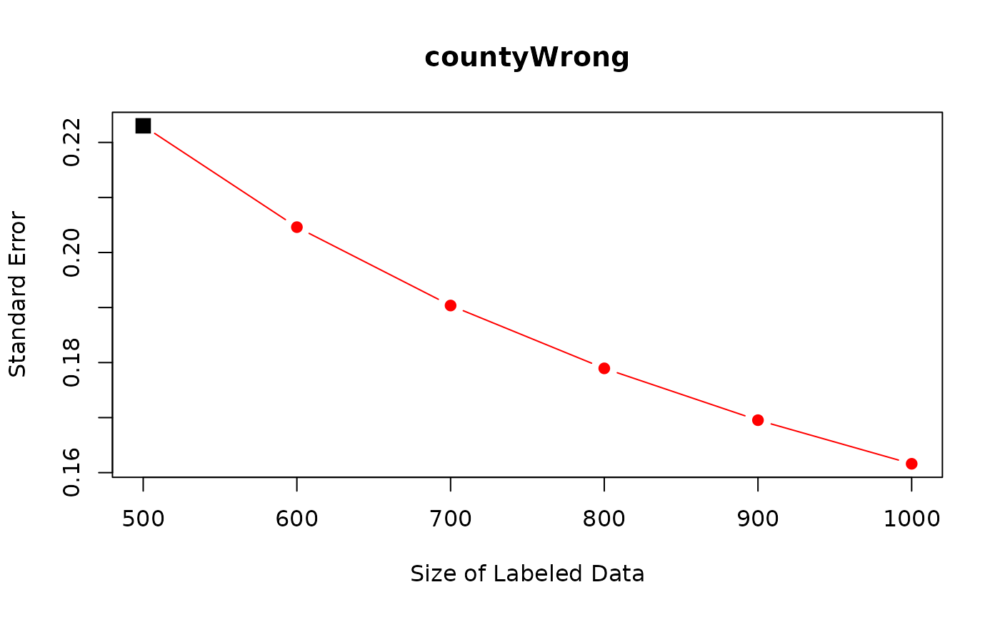

# Frequently Asked Questions

  

**On this page, we answer frequently asked questions.**

  

**Table of Contents**

- [How Many Documents Should Experts Annotate?](#power)  

- [What Types of Predicted Variables Can DSL Handle?](#variable)  

- [(More Complex) Sampling Strategies?](#sample)  

- [How Can We Implement Cluster Standard Errors in DSL?](#cluster)  

- [What if the Unit of Analysis is not the same as the Unit of
  Labeling?](#unit)  

- [How to use DSL for Estimating the Category Proportions over Time or
  across Groups?](#category)  

- [How Can We Internally Implement Supervised Machine Learning for
  Predictions?](#sl)  

  

#### **How Many Documents Should Experts Annotate?**

In practice, researchers might wonder how many documents they have to
expert annotate. To help researchers in such common scenarios, we
develop a data-driven power analysis: after annotating a small number of
documents, we can predict how many more documents researchers need to
annotate in order to achieve a user-specified size of standard error.

As an example, we use the data we introduced in the Get Started page.

``` r

library(dsl)
data("PanChen")
head(PanChen)
```

    ##   countyWrong pred_countyWrong SendOrNot prefecWrong connect2b prevalence
    ## 1           0                0         0           0         1          0
    ## 2           0                1         0           0         0          0
    ## 3           1                0         0           0         0          0
    ## 4          NA                0         0           0         1          0
    ## 5          NA                0         0           1         0          0
    ## 6          NA                0         0           0         1          0
    ##   regionj groupIssue
    ## 1       0          1
    ## 2       0          1
    ## 3       0          1
    ## 4       0          1
    ## 5       0          1
    ## 6       0          1

In particular, users can apply function
[`power_dsl()`](http://naokiegami.com/dsl/reference/power_dsl.md) to
predict standard errors with different size of expert-coded data.
Researchers can use the same arguments from `dsl` and add one argument
`labeled_size`, which represents the number of expert-coded documents
for which we predict standard errors. Recall that the current number of
expert-coded documents is 500.

``` r

power_out <- power_dsl(labeled_size = c(600, 700, 800, 900, 1000),
                       model = "logit", 
                       formula = SendOrNot ~ countyWrong + prefecWrong + 
                         connect2b + prevalence + regionj + groupIssue,
                       predicted_var = "countyWrong",
                       prediction = "pred_countyWrong",
                       data = PanChen)
```

    ## Cross-Fitting: 1/10..2/10..3/10..4/10..5/10..6/10..7/10..8/10..9/10..10/10..
    ## Power Analysis: 1/10..2/10..3/10..4/10..5/10..6/10..7/10..8/10..9/10..10/10..

``` r

summary(power_out)
```

    ## 
    ## ==========================
    ## Predicted Standard Errors:
    ## ==========================
    ##      (Intercept) countyWrong prefecWrong connect2b prevalence   regionj
    ## 500    0.3620969   0.2230176   0.2969560 0.1197007  0.1519793 0.4565769
    ## 600    0.3615976   0.2046064   0.2962925 0.1189793  0.1514914 0.4563394
    ## 700    0.3612406   0.1903684   0.2958177 0.1184612  0.1511421 0.4561697
    ## 800    0.3609726   0.1789480   0.2954611 0.1180712  0.1508795 0.4560424
    ## 900    0.3607640   0.1695345   0.2951835 0.1177670  0.1506749 0.4559433
    ## 1000   0.3605971   0.1616093   0.2949612 0.1175230  0.1505111 0.4558640
    ##      groupIssue
    ## 500   0.3596752
    ## 600   0.3596009
    ## 700   0.3595479
    ## 800   0.3595080
    ## 900   0.3594771
    ## 1000  0.3594523
    ## ---

The first row shows the current standard errors for coefficients. The
remaining rows show predicted standard errors.

Importantly, as we increase the number of expert annotations for
`countyWrong`, standard errors for `countyWrong` are predicted to
decrease sharply. For the other variables, we do not see similarly sharp
reduction because the other variables are already observed for the
entire data. Small reduction in their standard errors come from
correlations with `countyWrong`.

Researchers can use function `plot` to visualize the power analysis.

``` r

plot(power_out, coef_name = "countyWrong")
```



Finally, researchers can also apply
[`power_dsl()`](http://naokiegami.com/dsl/reference/power_dsl.md)
directly to the output from function
[`dsl()`](http://naokiegami.com/dsl/reference/dsl.md).

``` r

out <- dsl(model = "logit", 
           formula = SendOrNot ~ countyWrong + prefecWrong + 
             connect2b + prevalence + regionj + groupIssue,
           predicted_var = "countyWrong",
           prediction = "pred_countyWrong",
           data = PanChen)
```

    ## Cross-Fitting: 1/10..2/10..3/10..4/10..5/10..6/10..7/10..8/10..9/10..10/10..

``` r

power_out2 <- power_dsl(dsl_out = out, 
                        labeled_size = c(600, 700, 800, 900, 1000))
```

    ## 
    ## Power Analysis: 1/10..2/10..3/10..4/10..5/10..6/10..7/10..8/10..9/10..10/10..

``` r

summary(power_out2)
```

    ## 
    ## ==========================
    ## Predicted Standard Errors:
    ## ==========================
    ##      (Intercept) countyWrong prefecWrong connect2b prevalence   regionj
    ## 500    0.3620969   0.2230176   0.2969560 0.1197007  0.1519793 0.4565769
    ## 600    0.3615976   0.2046064   0.2962925 0.1189793  0.1514914 0.4563394
    ## 700    0.3612406   0.1903684   0.2958177 0.1184612  0.1511421 0.4561697
    ## 800    0.3609726   0.1789480   0.2954611 0.1180712  0.1508795 0.4560424
    ## 900    0.3607640   0.1695345   0.2951835 0.1177670  0.1506749 0.4559433
    ## 1000   0.3605971   0.1616093   0.2949612 0.1175230  0.1505111 0.4558640
    ##      groupIssue
    ## 500   0.3596752
    ## 600   0.3596009
    ## 700   0.3595479
    ## 800   0.3595080
    ## 900   0.3594771
    ## 1000  0.3594523
    ## ---

We can see that `power_out2` is identical to `power_out`.

  

#### **What Types of Predicted Variables Can DSL Handle?**

As we have shown in various examples in **[Get Started
Page](http://naokiegami.com/dsl/articles/intro.md)** and **[Models
Available in DSL](http://naokiegami.com/dsl/articles/model.md)**, users
can incorporate predicted variables (i.e., text-based variables) as the
outcome and/or independent variables.

For example, when users have text-based variables as both the outcome
and independent variables, they can specify them as a vector in
`predicted_var`.

``` r

data("data_logit") # example data 

head(data_logit)
```

    ##    Y         X1 pred_Y    pred_X1         X2          X3          X4
    ## 1  0 -0.1443742      0  0.9486148 -0.2079232 -0.06932595  1.65748976
    ## 2  1 -1.2864079      1 -1.8766233 -1.6961906 -0.27274691  1.54678252
    ## 3  1 -1.4665386      1 -2.4866911 -0.6212224 -0.70787173 -0.27913330
    ## 4  0 -1.3554115      1  0.5138155  1.2299990 -0.86519213  0.18177847
    ## 5 NA         NA      1 -2.1116582  0.6624512  1.19504665 -0.02724476
    ## 6 NA         NA      1 -0.6391120 -0.8971608  1.20072203 -0.51241357
    ##            X5          X6         X7        X8           X9        X10
    ## 1  0.96825927  0.05389556 -2.0762690 0.2653279  1.458743948  0.4127003
    ## 2 -0.46626141  0.73182950 -1.7677551 1.0790758 -0.003172833 -0.5313550
    ## 3 -0.26973904 -1.75925076 -0.1585703 0.6823146  0.050500221 -1.2679467
    ## 4  0.41947288 -0.32375937  0.3226157 0.5131867 -2.065367939  1.6111660
    ## 5 -0.94927647  1.01808653  0.7608077 1.6830265 -1.907959205 -0.6979879
    ## 6  0.09162689  1.15086391 -0.7917356 0.9765960 -0.144924483 -1.2848539

``` r

out_logit <- dsl(model = "logit", 
                 formula = Y ~ X1 + X2 + X4,
                 predicted_var = c("Y", "X1"),
                 prediction = c("pred_Y", "pred_X1"),
                 data = data_logit)
```

    ## Cross-Fitting: 1/10..2/10..3/10..4/10..5/10..6/10..7/10..8/10..9/10..10/10..

When there are more than one variable in `predicted_var`, rows that
observe all the variables in `predicted_var` are counted as labeled, and
rows that have at least one `NA` in variables in `predicted_var` are
counted as non-labeled.

  

#### **(More Complex) Sampling Strategies?**

Researchers might consider sampling strategies for expert annotations
other than random sampling with equal probabilities. As long as the
sampling probability for each document is decided by the researchers and
is greater than zero, DSL is applicable. For example, DSL allows
stratified or block sampling schemes (i.e., change the sampling
probability of documents based on document-level observed covariates)
and can cover any case where the sampling probability depends on the LLM
annotation, document-level covariates, independent variables, or the
outcome variable. This generality is important because researchers might
want to over-sample documents that are difficult to annotate.

In function [`dsl()`](http://naokiegami.com/dsl/reference/dsl.md), when
using these more complex sampling strategies, users should specify the
sampling probability of each document. For example, in the following
data set, we set the sampling probability for expert annotation to be
30% for documents with `X1 = 1` and set it to be 10% for documents with
`X1 = 0`. As you see below, variable `sample_prob` is `0.3` when
`X1 = 1` and `0.1` when `X1 = 0`. Thus, this is random sampling with
unequal probabilities.

``` r

data("data_unequal") # example data 
head(data_unequal)
```

    ##    Y pred_Y sample_prob X1         X2           X3
    ## 1  0      1         0.1  0 -0.7075315  0.774843489
    ## 2  0      0         0.1  0 -0.1282225 -0.351258120
    ## 3  0      1         0.3  1 -0.9908576  0.733213596
    ## 4 NA      1         0.3  1 -1.1068022 -0.403284103
    ## 5 NA      1         0.1  0  0.2493619  0.510531594
    ## 6 NA      1         0.1  0 -1.0298485  0.004936994

When running [`dsl()`](http://naokiegami.com/dsl/reference/dsl.md),
users just need to specify this unequal sampling probability in argument
`sample_prob`.

``` r

out_unequal <- dsl(model = "logit", 
                   formula = Y ~ X1 + X2 + X3,
                   predicted_var = c("Y"),
                   prediction = c("pred_Y"),
                   sample_prob = "sample_prob",
                   data = data_unequal)
```

    ## Cross-Fitting: 1/10..2/10..3/10..4/10..5/10..6/10..7/10..8/10..9/10..10/10..

``` r

summary(out_unequal)
```

    ## ==================
    ## DSL Specification:
    ## ==================
    ## Model:  logit
    ## Call:  Y ~ X1 + X2 + X3
    ## 
    ## Predicted Variables:  Y
    ## Prediction:  pred_Y
    ## 
    ## Number of Labeled Observations:  334
    ## Random Sampling for Labeling with Equal Probability:  No
    ## (Sampling probabilities are defined in `sample_prob`)
    ## 
    ## =============
    ## Coefficients:
    ## =============
    ##             Estimate Std. Error CI Lower CI Upper p value  
    ## (Intercept)  -0.2157     0.1185  -0.4480   0.0165  0.0687 .
    ## X1            0.1073     0.3349  -0.5491   0.7637  0.7487  
    ## X2            0.1074     0.1086  -0.1055   0.3203  0.3229  
    ## X3           -0.0449     0.1157  -0.2717   0.1820  0.6983  
    ## ---
    ## Signif. codes: 0 '***' 0.001 '**' 0.01 '*' 0.05 '.' 0.1 ' ' 1
    ## 95% confidence intervals (CI) are reported.

When users rely on random sampling with unequal probabilities,
`Random Sampling with Equal Probability` becomes `No`.

  

#### **How Can We Implement Cluster Standard Errors in DSL?**

Users need to supply a variable name that defines clusters to argument
`cluster` in function
[`dsl()`](http://naokiegami.com/dsl/reference/dsl.md). This option is
available for all model types (`lm`, `logit`, and `felm`).

``` r

data("data_felm") # example data 

out_felm_one <- dsl(model = "felm", 
                    formula = log_pcap ~ log_gsp + log_pc + unemp,
                    predicted_var =  "log_gsp",
                    prediction = "pred_log_gsp",
                    fixed_effect = "oneway", 
                    index = c("state"), 
                    cluster = "state",
                    data = data_felm)
```

    ## Cross-Fitting: 1/10..2/10..3/10..4/10..5/10..6/10..7/10..8/10..9/10..10/10..

``` r

summary(out_felm_one)
```

    ## ==================
    ## DSL Specification:
    ## ==================
    ## Model:  felm (oneway)
    ## Call:  log_pcap ~ log_gsp + log_pc + unemp
    ## Fixed Effects:  state
    ## 
    ## Predicted Variables:  log_gsp
    ## Prediction:  pred_log_gsp
    ## 
    ## Number of Labeled Observations:  334
    ## Random Sampling for Labeling with Equal Probability: Yes
    ## 
    ## =============
    ## Coefficients:
    ## =============
    ##         Estimate Std. Error CI Lower CI Upper p value    
    ## log_gsp   0.0031     0.0020  -0.0007   0.0069  0.1117    
    ## log_pc    0.5357     0.0419   0.4537   0.6178  0.0000 ***
    ## unemp     0.0067     0.0021   0.0025   0.0108  0.0016  **
    ## ---
    ## Signif. codes: 0 '***' 0.001 '**' 0.01 '*' 0.05 '.' 0.1 ' ' 1
    ## 95% confidence intervals (CI) are reported.
    ## Standard errors are clustered by state.

When users applied cluster standard errors, the level of clustering is
reported after the `Coefficients` table, e.g., as
`Standard errors are clustered by state`.

  

#### **What if the Unit of Analysis is not the same as the Unit of Labeling?**

In some applications, the unit of analysis is not the same as the unit
of labeling. Researchers often annotate each document, but the unit of
analysis might be some aggregates of documents. For example, users might
code whether each online post by political candidates mentions an
economic policy: the unit of labeling is at the online post level. But
researchers might be interested in how the proportion of posts
mentioning an economic policy varies between different candidates: the
unit of analysis is at the candidate level. Here, each candidate has
multiple posts, and the main text-based variable is defined as the
proportion of online posts mentioning an economic policy for each
candidate.

In such applications, how can users apply DSL? We provide step by step
guide **[here](http://naokiegami.com/dsl/articles/aggregate.md).**

  

#### **How to use DSL for Estimating the Category Proportions over Time or across Groups?**

Many scholars are interested in estimating the proportion of all
documents in each user-specified category. For example, we might study
how the proportion of censored documents changes over time, or how the
proportion of social media posts containing hate speech differs across
groups, such as Democrats and Republicans. These questions can be
analyzed within the DSL framework, too.

We start with the basic data structure for `dsl`. In this data, `Y`
denotes whether a document belongs to a category of interest, and
`pred_Y` denotes the predicted value. We estimate the category
proportions over time here as an example, but the same approach applies
to estimating the category proportions across groups.

``` r

data("data_time")
head(data_time)
```

    ##    Y pred_Y year
    ## 1  1      1 2001
    ## 2  1      0 2001
    ## 3  0      1 2001
    ## 4 NA      1 2001
    ## 5 NA      0 2001
    ## 6 NA      0 2001

To estimate the category proportions over time, researchers can regress
a text category on time using linear regression without an intercept.
This is numerically equivalent to computing the DSL estimates within
each year separately. To implement this, researchers can simply add `-1`
to `formula` to remove an intercept. Note that this estimation approach
uses the numerical equivalence between linear regression (`lm`) and
subgroup means (as scholars use linear regression to compute
difference-in-means in randomized experiments), and thus, researchers do
not need to use logistic regression (`logit`).

``` r

out_time <- dsl(model = "lm",
                formula = Y ~ as.factor(year) - 1,
                predicted_var = "Y",
                prediction = "pred_Y",
                data = data_time)
```

    ## Cross-Fitting: 1/10..2/10..3/10..4/10..5/10..6/10..7/10..8/10..9/10..10/10..

``` r

summary(out_time)
```

    ## ==================
    ## DSL Specification:
    ## ==================
    ## Model:  lm
    ## Call:  Y ~ as.factor(year) - 1
    ## 
    ## Predicted Variables:  Y
    ## Prediction:  pred_Y
    ## 
    ## Number of Labeled Observations:  500
    ## Random Sampling for Labeling with Equal Probability: Yes
    ## 
    ## =============
    ## Coefficients:
    ## =============
    ##                     Estimate Std. Error CI Lower CI Upper p value    
    ## as.factor(year)2001   0.6451     0.0652   0.5173   0.7729   0e+00 ***
    ## as.factor(year)2002   0.6234     0.0654   0.4953   0.7515   0e+00 ***
    ## as.factor(year)2003   0.2956     0.0808   0.1372   0.4541   3e-04 ***
    ## as.factor(year)2004   0.4444     0.0693   0.3087   0.5802   0e+00 ***
    ## as.factor(year)2005   0.6288     0.0722   0.4873   0.7703   0e+00 ***
    ## as.factor(year)2006   0.4275     0.0728   0.2849   0.5702   0e+00 ***
    ## as.factor(year)2007   0.5710     0.0766   0.4209   0.7211   0e+00 ***
    ## as.factor(year)2008   0.6703     0.0674   0.5381   0.8024   0e+00 ***
    ## as.factor(year)2009   0.4960     0.0639   0.3707   0.6212   0e+00 ***
    ## as.factor(year)2010   0.4761     0.0704   0.3381   0.6142   0e+00 ***
    ## ---
    ## Signif. codes: 0 '***' 0.001 '**' 0.01 '*' 0.05 '.' 0.1 ' ' 1
    ## 95% confidence intervals (CI) are reported.

Here, coefficients in front of each year are the estimated category
proportions for each year.

  

#### **How Can We Internally Implement Supervised Machine Learning for Predictions?**

One of the most common use cases of the package is when researchers have
LLM annotations as `prediction` for some key text-based variables
defined in `predicted_var`.

Alternatively, researchers can also internally implement the classical
supervised machine learning methods to make predictions using the
expert-coded data.

By building on `SuperLearner` package, we offer the following 41
supervised ML methods.

``` r

available_method()
```

    ##  [1] "grf"              "bartMachine"      "bayesglm"         "biglasso"        
    ##  [5] "caret"            "caret.rpart"      "cforest"          "earth"           
    ##  [9] "gam"              "gbm"              "glm"              "glm.interaction" 
    ## [13] "glmnet"           "ipredbagg"        "kernelKnn"        "knn"             
    ## [17] "ksvm"             "lda"              "leekasso"         "lm"              
    ## [21] "loess"            "logreg"           "mean"             "nnet"            
    ## [25] "nnls"             "polymars"         "qda"              "randomForest"    
    ## [29] "ranger"           "ridge"            "rpart"            "rpartPrune"      
    ## [33] "speedglm"         "speedlm"          "step"             "step.forward"    
    ## [37] "step.interaction" "stepAIC"          "svm"              "xgboost"

When researchers internally implement the classical supervised machine
learning methods, the data structure looks like the data used in the
classical supervised machine learning. In this example, `Y` requires
text annotation and there are 10 variables available to predict `Y`.

``` r

data("data_sl")  # example data 
head(data_sl)
```

    ##            Y          X1          X2         X3          X4         X5
    ## 1 -0.2050247 -0.09910396 -0.87960666  0.8015421  1.29028152  0.8532547
    ## 2 -1.4856037  1.23123941  1.99007602  0.3868839 -0.07223693 -1.2962462
    ## 3  0.9894281  0.46408759  0.42323988 -0.1097634  0.25241778 -0.9464925
    ## 4         NA -1.12227958 -0.06897893 -0.4601287  1.49975679  1.5618861
    ## 5         NA -0.67877168 -0.33290315 -1.4747134 -1.89504047  0.5137869
    ## 6         NA  0.04734624 -0.18367264 -1.1965101  0.11178831  0.1975828
    ##           X6         X7          X8         X9        X10
    ## 1 -0.4914913 -1.0640511  0.01688910  1.8391539 -2.3456977
    ## 2 -1.2428339  0.0644001  1.92829279 -1.3745543 -0.5644520
    ## 3  0.8812547  1.5719390 -1.31725336  0.9007558  0.4595894
    ## 4  0.2493619  0.5105316  0.02339191 -0.3850724 -1.2070657
    ## 5  0.2394639 -1.4016767 -0.30634290  1.5934046  0.4291247
    ## 6 -1.6337523 -0.3078537 -0.51741473 -1.1128772 -0.5747400

To internally implement supervised machine learning methods, users have
to decide on a supervised machine learning model (specified in
`sl_method`) and predictors (specified in `feature`). In `formula`,
researchers can then specify the downstream statistical model they run
after predicting `Y`. In this example, the main downstream analysis is
linear regression where the outcome is `Y` and independent variables are
`X1`,`X2`, and `X4`.

``` r

out_lm_grf <- dsl(model = "lm", 
                  formula = Y ~ X1 + X2 + X4,
                  predicted_var = c("Y"),
                  sl_method = "grf",
                  feature =  c("X1", "X2", "X3", "X4", "X5", "X6", "X7", "X8", "X9", "X10"),
                  data = data_sl)
```

    ## Cross-Fitting: 1/10..2/10..3/10..4/10..5/10..6/10..7/10..8/10..9/10..10/10..

Here, we set `sl_method = "grf"` to use generalized random forest as the
supervised machine learning model.

``` r

summary(out_lm_grf)
```

    ## ==================
    ## DSL Specification:
    ## ==================
    ## Model:  lm
    ## Call:  Y ~ X1 + X2 + X4
    ## 
    ## Predicted Variables:  Y
    ## Prediction:  with predictors specified in `covariates`
    ## 
    ## Number of Labeled Observations:  500
    ## Random Sampling for Labeling with Equal Probability: Yes
    ## 
    ## =============
    ## Coefficients:
    ## =============
    ##             Estimate Std. Error CI Lower CI Upper p value    
    ## (Intercept)   0.0288     0.0497  -0.0686   0.1262  0.5625    
    ## X1            0.3982     0.0533   0.2938   0.5026  0.0000 ***
    ## X2           -0.2433     0.0496  -0.3406  -0.1461  0.0000 ***
    ## X4           -0.2696     0.0498  -0.3672  -0.1720  0.0000 ***
    ## ---
    ## Signif. codes: 0 '***' 0.001 '**' 0.01 '*' 0.05 '.' 0.1 ' ' 1
    ## 95% confidence intervals (CI) are reported.

Finally, for many existing methods that require stringent assumptions
about prediction errors, they often have strict rules about whether
variables used in the prediction stage can overlap with variables in the
main analyses. Fortunately, in DSL, researchers do not need to worry
about these issues because DSL does not require any assumption about
prediction error. This is why researchers can include variables in the
main statistical analyses (`X1`, `X2`, and `X4`) in the prediction step
as well.
